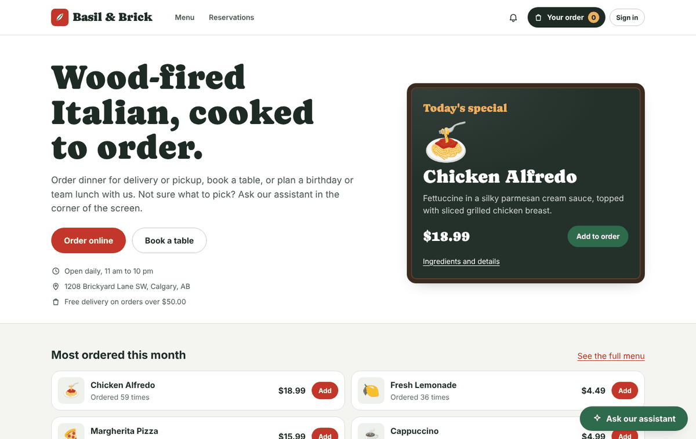
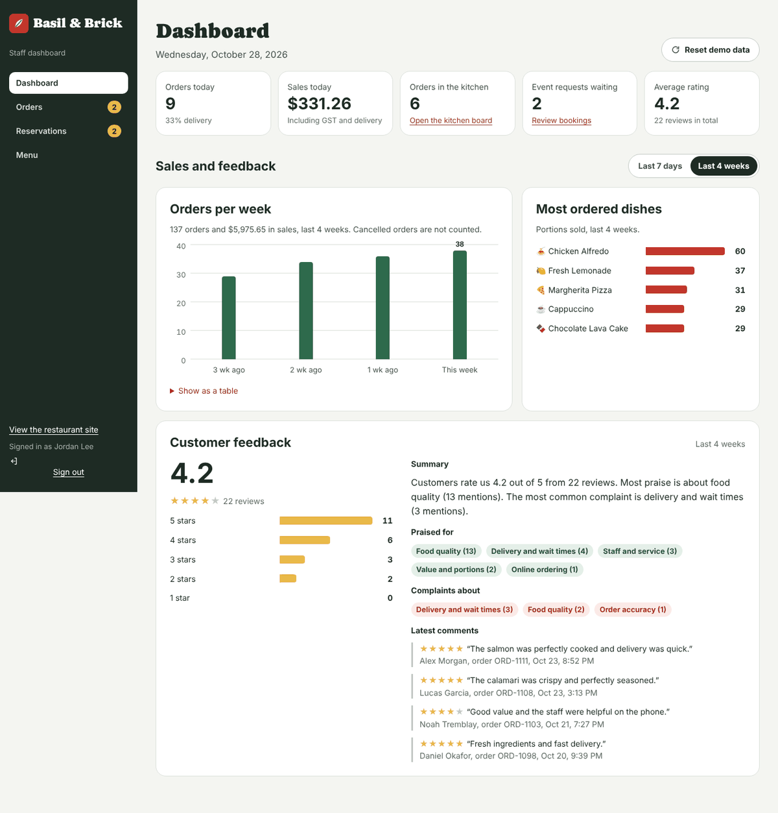
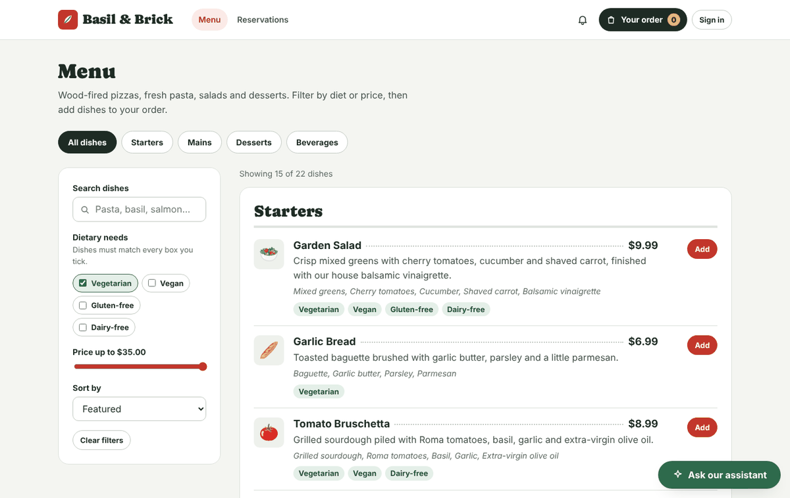
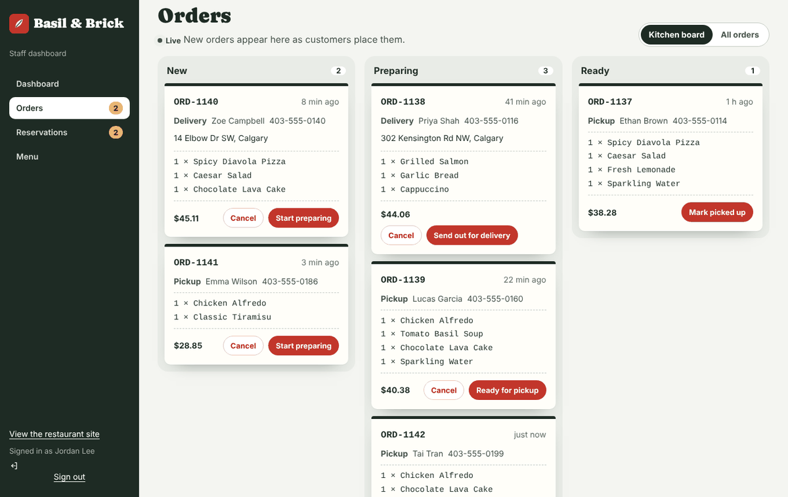
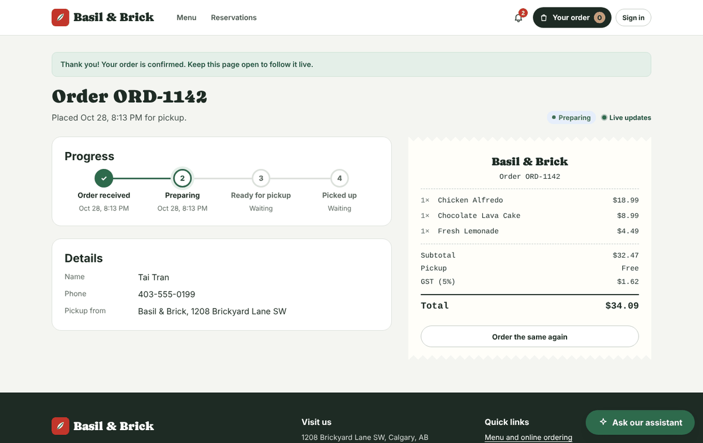
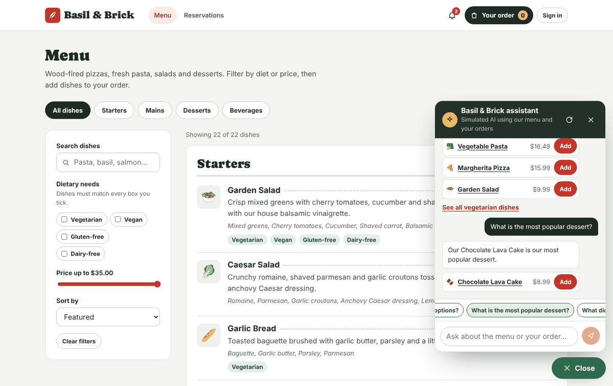

# Smart Restaurant Management System

**SODV2201 · Final Project · Assignment 1 · Tai Tran**

A React web app for a fictional Calgary restaurant, **Basil & Brick**. Customers
browse the menu, order for delivery or pickup, track their order live, book
tables or special events, and chat with an AI assistant. Staff use an admin
dashboard to manage the menu, move orders through the kitchen, approve bookings
and read sales and feedback analytics.

Built with **Vite 8**, **React 19**, **React Router 8** and the **Context API**.
Assignment 1 is the front end: data is kept in the browser (localStorage) behind
an async service layer that is ready to be pointed at a Node.js back end in the
next assignment.

| Customer | Admin |
|---|---|
|  |  |
|  |  |
|  |  |

---

## How to run

Requires **Node.js 22.22 or newer** (Node 24 LTS recommended; check with `node -v`).

```bash
npm install      # first time only
npm run dev      # then open http://localhost:5173
```

| Script | What it does |
|---|---|
| `npm run dev` | Start the development server with hot reload |
| `npm test` | Run the 71 unit tests (Vitest) |
| `npm run lint` | Check the code with Oxlint |
| `npm run build` | Production build into `dist/` |
| `npm run preview` | Serve the production build |

### Demo accounts

| Role | Email | Password |
|---|---|---|
| Customer | `customer@demo.com` | `demo123` |
| Admin | `admin@demo.com` | `admin123` |

The sign-in page has buttons that fill these in. Guests can also order and book
without an account.

**Tip for testing:** open the customer site in one tab and `/admin` in another.
Sign-ins are kept per tab, so one tab can be a guest or customer while the other
is the admin. Changes made in one tab appear in the other immediately.

---

## Features

### Customer
- **Menu** with categories (starters, mains, desserts, beverages), descriptions,
  ingredients, prices and dietary badges.
- **Search and filters**: text search (also searches ingredients), dietary needs
  (vegetarian, vegan, gluten-free, dairy-free), maximum price and sorting. Filters
  live in the URL, so the back button and shared links keep them.
- **Dish page** (`/menu/:itemId`) with ingredients and a quantity picker.
- **Cart**: change quantities, remove dishes, choose **delivery or pickup**, see
  the bill (GST 5%, $4.99 delivery, free over $50, $15 delivery minimum).
- **Checkout** with validation, then an **order confirmation** page that
  **tracks the order live** (Order received → Preparing → Ready → Delivered or
  Picked up) and asks for a rating once delivered.
- **Reservations**: tables (confirmed right away) or **special events** such as
  birthday parties and corporate gatherings (approved by the restaurant). Past
  and full time slots are disabled; each slot holds 40 guests.
- **Notifications**: a bell in the header shows order confirmations, booking
  confirmations and every status change made by the restaurant.
- **Optional account**: saved dietary preferences, order history with
  "Order again", and bookings with cancel.

### AI assistant (Assignment 1 AI feature, Option 2: simulated locally)
A chat window on every customer page. It answers the six sample questions from
the brief with the brief's responses, and many other ways of asking them. Its
answers come from live data, so they stay correct when the menu or orders change.
See [How the AI assistant works](#how-the-ai-assistant-works).

### Admin dashboard (`/admin`)
- **Dashboard**: orders and sales today, orders in the kitchen, event requests
  waiting, average rating; orders per day or week; most ordered dishes; a
  written **summary of customer feedback** with praise and complaint themes.
- **Orders**: a kitchen board (New → Preparing → Ready) with one button per next
  step, cancel with confirmation, and a searchable order history. New orders
  appear without refreshing.
- **Reservations**: filter by status, type and date; approve event requests or
  cancel bookings. Customers are notified either way.
- **Menu**: create, edit and delete dishes, mark dishes sold out (updates the
  customer menu in real time) and choose today's special.
- **Reset demo data** to restore the starting sample data.

---

## Where each requirement is covered

| Requirement (Assignment 1) | Where |
|---|---|
| Browse the menu by category with descriptions, ingredients and prices | `pages/Menu.jsx`, `components/menu/MenuItemRow.jsx`, `pages/MenuItemDetail.jsx`, `data/menuItems.js` |
| Filter or search by category, dietary restrictions or price | `components/menu/MenuFilters.jsx`, `utils/menuFilters.js` |
| Order for delivery or pickup, manage the cart | `pages/Cart.jsx`, `context/CartProvider.jsx`, `components/orders/OrderTypePicker.jsx` |
| Order confirmation and order status updates | `pages/Checkout.jsx`, `pages/OrderStatus.jsx`, `components/orders/OrderTracker.jsx`, `services/orderService.js` |
| Book tables for a date and time; reserve special events | `pages/Reservations.jsx`, `services/reservationService.js`, `utils/reservations.js` |
| Confirmation notifications after a reservation | `services/notificationService.js`, `components/layout/NotificationBell.jsx` |
| Optional accounts: save preferences, order history, manage reservations | `pages/Login.jsx`, `pages/Register.jsx`, `pages/Account.jsx`, `services/authService.js` |
| AI assistant: recommendations from previous orders or popular items, specials, dietary questions | `components/chat/ChatWidget.jsx`, `services/aiService.js`, `data/aiDataset.js` |
| Admin CRUD for menu items and real-time availability | `pages/admin/AdminMenu.jsx`, `components/admin/MenuItemForm.jsx`, `services/menuService.js` |
| Admin monitors orders and updates status (preparing, ready, delivered) | `pages/admin/AdminOrders.jsx`, `components/admin/OrderTicket.jsx` |
| Admin manages reservations and events (approve or cancel) | `pages/admin/AdminReservations.jsx` |
| Optional analytics: orders per day/week, popular items, feedback summary | `pages/admin/AdminDashboard.jsx`, `components/admin/Charts.jsx`, `utils/analytics.js` |
| Error handling | `components/common/ErrorBoundary.jsx`, `services/apiError.js`, `utils/validation.js`, `pages/NotFound.jsx` |
| Verifying operation | `*.test.js` files (71 tests), `npm run lint`, `npm run build` |

### React concepts used

| Concept | Examples |
|---|---|
| Components and props | `MenuItemRow` (item, inCart, onAdd), `GuestCheck` (lines, totals, type), `OrderTicket` |
| Callbacks from child to parent | `onAdd`, `onChange`, `onSubmit`, `onCancel`, `onAdvance` |
| `useState` | forms, filters, chat messages, dialogs |
| `useEffect` | real-time sync subscription, saving the cart, closing the bell on outside click, auto-scroll in chat |
| `useRef` | uncontrolled sign-in form, `<dialog>` element, chat scroll and focus |
| `useMemo` / `useCallback` | context values and actions in the providers |
| Context API | `RestaurantProvider`, `AuthProvider`, `CartProvider`, `ToastProvider` + hooks `useRestaurant`, `useAuth`, `useCart`, `useToast` |
| Custom hook | `hooks/useNow.js` |
| React Router | layout routes with `<Outlet />`, `NavLink`, `useParams`, `useSearchParams`, `useNavigate`, `useLocation`, `<Navigate />`, protected routes, 404 route |
| Controlled vs uncontrolled inputs | controlled: checkout, booking, register, admin forms · uncontrolled: `Login.jsx` (`useRef`) |
| Conditional rendering and lists | empty states, sold-out badges, status trackers, `map()` everywhere |
| Error boundary (class component) | `components/common/ErrorBoundary.jsx` |

---

## How the AI assistant works

The brief allows two options; this project uses **Option 2, simulate the AI
locally**. The dataset in `src/data/aiDataset.js` contains the six sample
questions and responses from the brief, unchanged:

| Customer question | Response |
|---|---|
| What are today's specials? | Today's special is Chicken Alfredo for $18.99. |
| What vegetarian meals do you have? | We offer Vegetable Pasta, Margherita Pizza, and Garden Salad. |
| What do you recommend? | Based on popular orders, we recommend our Chicken Alfredo. |
| Do you have gluten-free options? | Yes. We offer gluten-free pasta and selected salads. |
| What is the most popular dessert? | Our Chocolate Lava Cake is our most popular dessert. |
| What did I order last time? | Your previous order was Chicken Alfredo and Chocolate Lava Cake. |

`src/services/aiService.js` turns a message into an answer in three steps:

1. **Normalize** the text (lower case, no punctuation): `"Gluten-free?"` → `gluten free`.
2. **Detect the intent** by scoring keywords; a phrase of N words is worth N
   points, and a more specific topic (dessert) beats a general one (recommend).
3. **Build the answer from live data**: today's special comes from the menu,
   "most popular" from all orders, "last time" from the customer's own orders,
   and recommendations also use saved dietary preferences and suggest a dish the
   customer has not tried yet.

With the starting data the answers are word for word the responses above (the
last-order question needs the demo customer, who has that order). If the admin
changes the special, or new orders change what is popular, the answers follow.
Extra intents cover opening hours, location, delivery, bookings, vegan and
dairy-free dishes, order status and allergies, with a polite fallback for
anything else. `src/services/aiService.test.js` checks all of this.

Moving to Option 1 later (Gemini, Groq or Ollama) only changes
`getAssistantReply()`: it would send the message and the same context to the
Node.js back end, which calls the model so the API key never reaches the browser.

---

## How the data flows

```
main.jsx
└── BrowserRouter
    └── ToastProvider            pop-up messages            useToast()
        └── RestaurantProvider   menu, orders, bookings…    useRestaurant()
            └── AuthProvider     signed-in user (per tab)   useAuth()
                └── CartProvider cart + delivery/pickup     useCart()
                    └── App      routes
                        ├── CustomerLayout  header, footer, chat, <Outlet />
                        └── AdminLayout     sidebar, <Outlet />   (admins only)
```

```
Component ──calls──▶ context action ──calls──▶ service ──reads/writes──▶ localStorage "database"
    ▲                                              │ (validates, throws ApiError)
    └────────── re-render with new data ◀──────────┘
Other tabs ◀── "storage" event ── subscribeToDatabase() keeps every tab in sync
```

- **Services are async** (`src/services/`), like calls to a real API. Pages
  already handle loading states and errors, so in Assignment 2 each service can
  switch to `fetch('/api/...')` against Express without changing the pages.
- **Validation runs twice**: in the form for instant feedback, and again in the
  service, the way a server must never trust the browser.
- **Prices are never trusted from the cart**: `placeOrder` re-prices every dish
  from the current menu and refuses sold-out dishes.
- **Real time**: when one tab saves the database, the browser fires a `storage`
  event in the other tabs; `RestaurantProvider` reloads, so the kitchen board,
  the customer's tracking page and the menu update immediately.

## Folder structure

```
src/
├── App.jsx                 Route table (customer + admin)
├── main.jsx                Entry point: router + context providers
├── index.css               Imports every stylesheet
├── components/
│   ├── admin/              Charts, MenuItemForm, OrderTicket
│   ├── chat/               ChatWidget (AI assistant)
│   ├── common/             Badges, ErrorBoundary, Feedback (spinner, empty state),
│   │                       FormFields, Icon, Modal/ConfirmDialog, ProtectedRoute,
│   │                       QuantityStepper
│   ├── layout/             CustomerLayout, AdminLayout, Navbar, Footer, NotificationBell
│   ├── menu/               MenuFilters, MenuItemRow
│   ├── orders/             GuestCheck (the bill), OrderTracker, OrderTypePicker, FeedbackForm
│   └── reservations/       ReservationList
├── context/                Providers (.jsx) and their hooks (.js)
├── data/                   Restaurant rules, menu, AI dataset, seed data
├── hooks/                  useNow
├── pages/                  Home, Menu, MenuItemDetail, Cart, Checkout, OrderStatus,
│   │                       Reservations, Login, Register, Account, NotFound
│   └── admin/              AdminDashboard, AdminOrders, AdminReservations, AdminMenu
├── services/               database, storage, apiError, network, auth, menu, order,
│                           reservation, notification and AI services (+ tests)
├── styles/                 tokens, base, layout, components, and one file per area
└── utils/                  format, pricing, validation, reservations, menuFilters,
                            analytics, ids, dom (+ tests)
```

## Error handling

- **Forms** show a message under each invalid field (`aria-invalid` +
  `aria-describedby`), a summary at the top, and move focus to the first problem.
- **Services** throw `ApiError` with a readable message and field errors; pages
  catch them with `try/catch` and show them in the form or as a toast.
- **Business rules** are enforced in the services: sold-out dishes, delivery
  minimum, seat capacity, allowed status changes, duplicate dish names or emails.
- **Storage problems** (private mode, full storage, broken JSON) are caught in
  `storage.js`; broken data is replaced with fresh seed data.
- **Rendering errors** are caught by `ErrorBoundary`, so one broken page shows a
  message instead of a blank screen.
- **Not found**: unknown URLs, deleted dishes and unknown order numbers all show
  a helpful empty state.

## Testing

```bash
npm test         # 71 unit tests
npm run lint     # 0 warnings
npm run build    # production build
```

The tests cover the bill calculation, every validation rule, menu filters,
dashboard analytics, the order and reservation rules (using an in-memory
localStorage) and the AI assistant, including all six sample questions.

## Development phases

The Git history follows the build: project set-up and configuration, clean-up
of the Vite starter, data layer and services, context providers, layout and
routing, menu, cart and checkout, reservations, accounts, AI assistant, admin
menu, orders and reservations, dashboard, tests and documentation.

## Next: Assignment 2

Replace the browser storage with a **Node.js + Express** API and a database. The
services in `src/services/` already have the shape of API calls, so each one
becomes a `fetch()` to an endpoint such as `GET /api/menu` or
`PATCH /api/orders/:id/status`, and the AI assistant can call a real model
from the server.

---

*Basil & Brick is fictional. The display font is Caprasimo (SIL Open Font
License), installed from npm. Dish pictures are emoji.*
